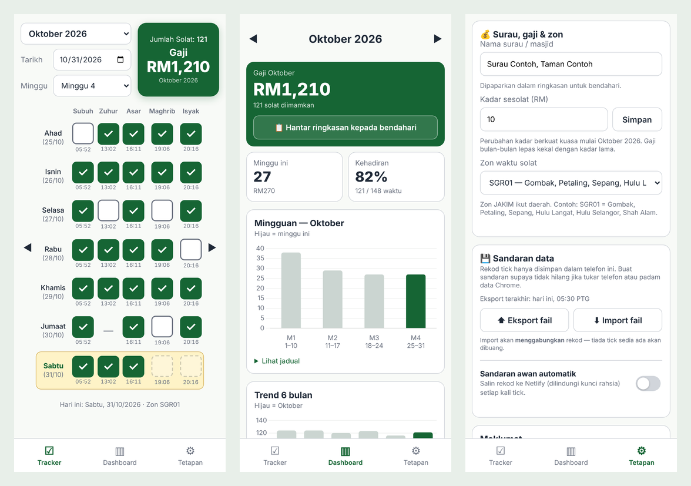
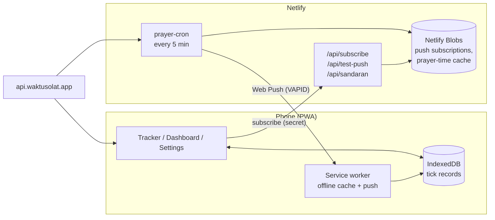

# Imam Tracker

A mobile-first Progressive Web App that helps a mosque/surau imam in Malaysia log the five daily (fardu) prayers they lead, and works out their monthly pay.

> **Bahasa Melayu:** Aplikasi web (PWA) untuk imam surau/masjid mencatat solat fardu yang diimamkan dan mengira gaji bulanan. Panduan penuh dalam Bahasa Melayu: [docs/PANDUAN.md](docs/PANDUAN.md).



## Why

Many surau pay their imam per prayer led, and the treasurer asks for a total at the end of each month. Keeping that count in a notes app means typing the same grid again every week and forgetting to fill it in. Imam Tracker turns it into one tap per prayer, a phone reminder when each prayer time begins, and a report ready to send at the end of the month.

## Features

- **One-tap tracker.** A weekly grid of Subuh, Zuhur, Asar, Maghrib and Isyak. Running count and pay update as you tap.
- **Real prayer times.** Pulls official JAKIM times for your zone from [api.waktusolat.app](https://api.waktusolat.app). A box stays locked until its prayer time has started, and past days can always be filled in later.
- **Push reminders.** A notification a few minutes *before* each prayer time ("get ready to lead"), and another about 30 minutes after with a **✅ Yes, record it** button that logs the prayer without opening the app.
- **Dashboard.** Monthly pay, attendance %, a weekly bar chart, a 6-month trend and a per-prayer breakdown.
- **Treasurer report.** One button shares a formatted monthly summary to WhatsApp (or copies it).
- **Works offline and installs to the home screen.** Built as a PWA with a service worker.
- **Private by default.** Records live only on your phone (IndexedDB). Cloud backup is opt-in.
- **Local rules built in.** Sunday–Saturday weeks with short weeks at the start and end of a month merged in, no Zuhur on Fridays (no Friday prayer at the surau), and rate changes that apply from the current month without changing past pay.

## Tech stack

| Layer | Choice |
|---|---|
| Frontend | Vanilla JavaScript + [Vite](https://vite.dev), no framework |
| PWA | [vite-plugin-pwa](https://vite-pwa-org.netlify.app) (injectManifest), Workbox |
| Storage | IndexedDB via [idb-keyval](https://github.com/jakearchibald/idb-keyval) |
| Charts | [Chart.js](https://www.chartjs.org) |
| Backend | [Netlify Functions](https://docs.netlify.com/build/functions/overview/) + Scheduled Functions |
| Server storage | [Netlify Blobs](https://docs.netlify.com/build/data-and-storage/netlify-blobs/) |
| Push | Web Push (VAPID) via [web-push](https://github.com/web-push-libs/web-push) |
| Prayer times | [api.waktusolat.app](https://api.waktusolat.app/docs) (JAKIM e-Solat data) |

## How it works



1. The phone subscribes to Web Push and registers the subscription with `/api/subscribe`, protected by a shared secret.
2. Every 5 minutes, `prayer-cron` checks today's prayer times for each subscribed zone. A "time to lead" push goes out in the 0–6 minutes **before** each prayer time and a "record it" push goes out about 30 minutes after. A sent-log in Blobs prevents duplicates.
3. The service worker shows the notification. If you tap **✅**, it writes the tick straight into IndexedDB.

The scheduling logic lives in [`netlify/lib/jadual.mjs`](netlify/lib/jadual.mjs) with no dependencies, so it can be tested in isolation. It was checked against simulated 5-minute cron runs with random jitter, with no late or duplicate notifications.

## Getting started

**Requirements:** Node.js 20+

```bash
git clone https://github.com/<your-username>/imam-tracker.git
cd imam-tracker
npm install
npm run dev          # http://localhost:5173
```

The tracker, dashboard and offline cache all work locally. Push notifications need the Netlify Functions, so they only work once deployed.

```bash
npm run build && npm run preview   # test the PWA / service worker on http://localhost:4173
```

## Deploy your own

1. Fork this repo and import it into Netlify (**Add new project → Import an existing project**). `netlify.toml` already holds the build settings.
2. Generate keys:
   ```bash
   npx web-push generate-vapid-keys
   node -e "console.log(require('crypto').randomBytes(24).toString('base64url'))"
   ```
3. Add these environment variables in Netlify (see [`.env.example`](.env.example)), then redeploy:

   | Variable | Value | Secret? |
   |---|---|---|
   | `VAPID_PUBLIC_KEY` | VAPID public key | No |
   | `VAPID_PRIVATE_KEY` | VAPID private key | **Yes** |
   | `VAPID_SUBJECT` | `mailto:you@example.com` | No |
   | `SUBSCRIBE_SECRET` | the random string from step 2 | **Yes** |

4. Open the site on your phone in Chrome and install it. Then go to **Tetapan** (Settings), set your surau name, zone and rate, paste the secret and turn on notifications.

A step-by-step guide in Bahasa Melayu, including Android battery settings that can block push, is in [docs/PANDUAN.md](docs/PANDUAN.md).

## Security & privacy

- **No accounts, no central database of records.** Prayer records stay in the browser's IndexedDB on each device. The server only stores push subscriptions, a prayer-time cache and a short-lived sent-log.
- **Shared-secret auth** on every state-changing endpoint, compared with `crypto.timingSafeEqual` over SHA-256 digests.
- **Input validation.** Subscription endpoints must be HTTPS URLs, zone codes are pattern-checked, backup payloads are size-capped and stripped down to valid `YYYY-MM-DD → {prayer: true}` entries, and imported files go through the same filter.
- **No secrets in the repo.** All keys are Netlify environment variables. Exported backup files never include the secret.
- **Cloud backup is opt-in** and can be deleted from the server when you turn it off.
- Dead push subscriptions (HTTP 404/410) are removed automatically.

Found a security issue? Please open a private [security advisory](../../security/advisories/new) rather than a public issue.

## Project structure

```
src/
  main.js            routing, swipe navigation, refresh on focus
  views/             tracker.js, dashboard.js, tetapan.js (settings)
  dates.js           Malay day/month names, week splitting rules
  db.js              IndexedDB records, settings, rate history, merge
  api.js             prayer times + zone list (cached)
  statistik.js       dashboard calculations
  push.js            subscribe / unsubscribe / test
  sandaran.js        export / import / optional cloud backup
  ringkasan.js       treasurer summary text
  sw.js              service worker: precache, push, notification actions
netlify/
  functions/         vapid, subscribe, test-push, sandaran, prayer-cron (scheduled)
  lib/jadual.mjs     notification timing logic (pure)
  lib/server.mjs     Blobs, web-push, auth helpers
```

The code uses Malay names for variables and comments (for example `rekod` = records, `waktu` = prayer time, `tetapan` = settings, `sandaran` = backup), since the app is built for Malay-speaking users.

## Acknowledgements

- Prayer times: [Waktu Solat API](https://api.waktusolat.app) by the [mptwaktusolat](https://github.com/mptwaktusolat) project, sourced from JAKIM e-Solat.

## License

[MIT](LICENSE)
